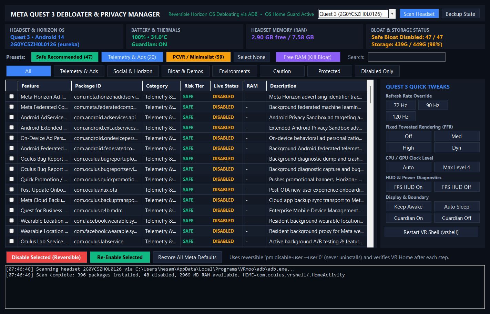
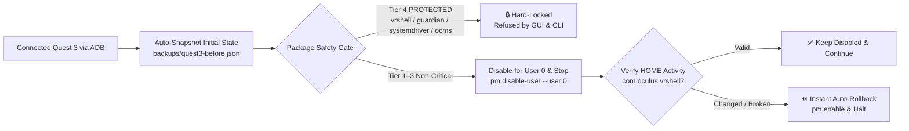

<div align="center">

# 🥽 Meta Quest 3 Debloater & Privacy Manager

**Safe, 100% Reversible ADB Debloating, Telemetry Control, and Horizon OS Tweaks for Meta Quest 3 / 3S / 2**

[](https://www.meta.com/quest/)
[-8b5cf6?style=for-the-badge)](#live-device-verification)
[](#quick-start)
[-f59e0b?style=for-the-badge)](#how-safety-works)
[](LICENSE)

*Disable Horizon Worlds bloat, advertising IDs, background federated learning, promo nags, and preinstalled demo apps without root — backed by automatic VR Home rollback protection.*

</div>

---

## 🖥️ Desktop Application Preview



> Also includes a standalone interactive browser selector ([`quest-debloat-selector.html`](quest-debloat-selector.html)) and cross-platform scripts for **PowerShell** (`scripts/debloat.ps1`) and **Bash** (`scripts/debloat.sh`).

---

## 🛡️ Architecture & Safety Pipeline

Because Meta Quest 3 headsets ship with a **locked bootloader** (`ro.boot.flash.locked=1`, `ro.boot.verifiedbootstate=green`), modifying `/system` is neither possible nor necessary. Every toggle uses user-space disabling (`pm disable-user --user 0`) and **never uninstalls** system packages:



### What Makes This Safe
- **Zero Uninstalls**: Disabled apps stay untouched on `/system` or `/product` and can be restored in seconds with `restore.ps1`, `restore.sh`, or **Restore All Meta Defaults**.
- **Hard-Locked Protected Tier**: 42 core OS, OpenXR runtime, Guardian, driver, Bluetooth/audio, and USB ADB packages cannot be checked or disabled even manually.
- **Per-Package HOME Integrity Check**: After disabling each package, the tool queries `cmd package resolve-activity` for `android.intent.category.HOME`. If the default VR launcher is no longer `com.oculus.vrshell`, it immediately re-enables the offending package and stops.
- **Full Pre-Debloat Backup**: Automatically records previously disabled packages before touching anything (`backups/quest3-<serial>-before.json`).

---

## 📊 Verified Live Results (Meta Quest 3 • `eureka` • Android 14)

Verified directly over ADB on stock locked Meta Quest 3 firmware (`UP1A.231005.007.A1`):

| Metric | Before Debloat (`status`) | After `apply --preset safe` |
| :--- | :--- | :--- |
| **Safe Tier Packages Disabled** | `0 / 47` | **`47 / 47` Disabled** |
| **Total Disabled Packages** | `1 / 396` (`com.meta.credentialsmanager`) | **`48 / 396`** |
| **Protected Core Packages** | `0 / 42` disabled | **`0 / 42` disabled (Locked)** |
| **VR Home Activity Check** | `com.oculus.vrshell/.HomeActivity` | **`com.oculus.vrshell/.HomeActivity`** |
| **Background Bloat Targets Stopped** | `0` | **`47` telemetry, QA, promo & bloat targets stopped** |

---

## 🚀 Quick Start

### Prerequisites
1. Enable **Developer Mode** on your Meta Quest 3 (Meta Horizon mobile app -> *Devices -> Headset Settings -> Developer Mode*).
2. Connect your Quest 3 via USB-C (or Wireless ADB) and accept the **"Allow USB debugging?"** prompt inside the headset.
3. Have **ADB** installed (auto-detected from `PATH`, `Android\Sdk\platform-tools`, `platform-tools`, or `Programs\VRmoo\adb\adb.exe`).

### Option A: Windows Desktop GUI (Recommended)
Download [`QuestDebloater-win-x64.zip`](../../releases) (or build from source with `pwsh .\build.ps1`):
```powershell
# Launch the dark-theme desktop GUI
.\dist\QuestDebloater.exe
```

### Option B: Fast CLI Mode
```powershell
# Inspect headset telemetry, memory, and package counts
.\dist\QuestDebloater.exe status

# Save a timestamped backup snapshot
.\dist\QuestDebloater.exe backup

# Apply Safe Recommended preset (47 telemetry, ad, promo, QA & demo packages)
.\dist\QuestDebloater.exe apply --preset safe

# Or apply Telemetry & Ads only (20 packages) / PCVR Minimalist (59 packages)
.\dist\QuestDebloater.exe apply --preset telemetry
.\dist\QuestDebloater.exe apply --preset pcvr

# Restore everything back to Meta defaults
.\dist\QuestDebloater.exe restore
```

### Option C: Cross-Platform PowerShell & Bash Scripts
```powershell
# Windows PowerShell
pwsh .\scripts\debloat.ps1 -Preset safe
pwsh .\scripts\restore.ps1
```
```bash
# macOS / Linux / Git Bash / WSL
./scripts/debloat.sh safe
./scripts/restore.sh
```

### Option D: Interactive HTML Selector
Open [`quest-debloat-selector.html`](quest-debloat-selector.html) in any browser to customize individual packages and copy one-line ADB disable / restore commands.

---

## 📦 Curated Package Reference (84 Horizon OS Packages)

### Tier 1 — `SAFE` (`47` packages — Default Recommended Preset)
Disables zero-risk advertising, federated learning, background bug uploaders, promotional banners, A/B experimentation (`labservice`), enterprise MDM/OEM agents, QA automation, wearable location polling, preinstalled social/demo wrappers, and unused phone/TV stubs while keeping the Meta Store, Browser, Link/Air Link, and all VR games working normally.

<details>
<summary><strong>1. Telemetry, Advertising, QA & Enterprise (20 packages — "Telemetry & Ads Only" Preset)</strong></summary>

| Package ID | Component | Purpose & Impact of Disabling |
| :--- | :--- | :--- |
| `com.meta.horizonadidservice` | Meta Horizon Ad ID Service | Stops Horizon advertising ID tracking & ad attribution |
| `com.meta.federatedcomputing.oculus` | Meta Federated Computing | Stops background ML training & telemetry harvesting |
| `com.android.adservices.api` | Android AdServices API | Disables Privacy Sandbox ad targeting API |
| `com.android.ext.adservices.api` | Extended AdServices API | Disables extended Android ad attribution background daemon |
| `com.android.ondevicepersonalization.services` | On-Device Personalization | Disables behavioral ad profiling engine |
| `com.android.federatedcompute.services` | Android Federated Compute | Stops background Android federated compute telemetry |
| `com.oculus.bugreportuploader` | Bug Report Uploader | Prevents background diagnostic & crash uploads to Meta |
| `com.oculus.bugreportservice` | Bug Report Service | Stops idle bug report collection daemon |
| `com.oculus.quickpromotionservice` | Quick Promotion / Upsells | Eliminates in-VR Horizon+ banners & promotional popups |
| `com.oculus.nux.ota` | Post-OTA Onboarding Nags | Stops post-update promotional cards & wizards |
| `com.oculus.backuptransportservice` | Meta Cloud Backup Transport | Stops background cloud sync telemetry (ADB backups unaffected) |
| `com.oculus.q4b.mdm` | Quest for Business MDM | Disables unused enterprise device management daemon |
| `com.facebook.wearable.system.location.service` | Wearable Location Service | Stops resident background location tracking (~110 MB RSS) |
| `com.facebook.wearable.system.location.proxy` | Wearable Location Proxy | Stops background location polling proxy (~87 MB RSS) |
| `com.oculus.labservice` | Oculus Lab Service | Stops active A/B experimentation telemetry daemon (~93 MB PSS) |
| `com.oculus.oemconfig` | Oculus Enterprise OEM Config | Disables enterprise OEM configuration agent (~107 MB PSS) |
| `com.meta.automation.pauldron.vr` | Meta Pauldron QA Automation | Disables internal Meta QA test runner agent |
| `com.oculus.appautomation` | Oculus App Automation | Disables automated UI test harness service |
| `com.android.cts.ctsshim` | Android CTS Test Shim | Disables empty Android Compatibility Test Suite validation shim |
| `com.android.cts.priv.ctsshim` | Privileged CTS Test Shim | Disables empty privileged CTS validation shim |

</details>

<details>
<summary><strong>2. Social Bloat, Preinstalled Demos & Unused Phone/TV Stubs (27 additional packages)</strong></summary>

| Package ID | Component | Notes |
| :--- | :--- | :--- |
| `com.facebook.horizon` | Meta Horizon Worlds | Removes Horizon Worlds & feed clutter |
| `com.oculus.facebook` | Facebook VR App | Preinstalled Facebook wrapper |
| `com.oculus.igvr` | Instagram VR App | Preinstalled Instagram wrapper |
| `com.oculus.thvr` | Threads VR App | Preinstalled Threads wrapper |
| `com.facebook.arvr.quillplayer` | Theater Elsewhere / Quill | Preinstalled showcase player |
| `com.oculus.samples.firsthand` | First Hand Demo | Preinstalled hand tracking demo |
| `com.meta.handseducationmodule` | Hands Education Module | Interactive gesture onboarding overlay |
| `com.meta.curio.ruler` | Curio MR Ruler | Preinstalled MR novelty app |
| `com.meta.curio.toybox` | Curio MR Toybox | Preinstalled MR novelty app |
| `com.oculus.assistant` | Meta Voice Assistant | Background voice trigger listener |
| `com.oculus.guidebook` | Quest Guidebook | Resident onboarding tips service (~112 MB RSS) |
| `com.oculus.helpcenter` | Meta Help Center | Support article viewer (~118 MB RSS) |
| `com.oculus.vrprivacycheckup` | VR Privacy Checkup | Periodic privacy wizard nag |
| `com.oculus.panelapp.calendar` | Oculus Calendar Panel | Legacy Home calendar widget |
| `com.meta.environment.prod.nuxd` | Meta NUX Onboarding Daemon | New-user onboarding daemon unneeded after setup |
| `com.meta.surfacetypingnux` | Surface Typing Tutorial | Onboarding direct-touch typing tutorial |
| `com.meta.HyperscapeHmdCapture` | Hyperscape Room Capture | Cloud photogrammetry capture (keeps Guardian intact) |
| `com.oculus.panelapp.kiosk` | Retail Kiosk Mode Panel | Commercial store demo kiosk panel |
| `com.microsoft.rdc.androidx` | Microsoft Windows App | Preinstalled Remote Desktop client stub |
| `com.android.managedprovisioning` | Work Profile Provisioning | Corporate BYOD MDM provisioning wizard (~95 MB PSS) |
| `com.android.providers.tv` | Android TV Provider | Unused TV tuner/channel database (~99 MB PSS) |
| `com.android.providers.calendar` | Calendar Storage Provider | Background calendar DB waking up in RAM (~99 MB PSS) |
| `com.android.healthconnect.controller` | Health Connect Controller | Phone fitness/health data controller UI |
| `com.android.health.connect.backuprestore` | Health Connect Backup | Background Health Connect cloud backup helper |
| `com.android.bookmarkprovider` | Legacy Bookmark Provider | Obsolete AOSP browser bookmark provider |
| `com.android.providers.blockednumber` | Blocked Number Provider | Phone call-blocking DB (no cellular radio on Quest) |
| `com.android.nearby.halfsheet` | Nearby Share Halfsheet | Google Nearby device pairing popup stub |

</details>

---

### Tier 2 — `MODERATE` (`12` additional packages — Included in "PCVR / Minimalist" Preset)
Ideal if you primarily use **Virtual Desktop**, **ALVR**, or **sideloaded APKs** and do not use Meta Parties, Avatars, Quest TV, Media Player, or extra 3D Home environments:
- `com.oculus.socialplatform` (Parties/Friends notifications, ~127 MB RSS), `com.oculus.presence` (Online presence), `com.oculus.avatareditor`, `com.oculus.tv`, `com.oculus.remotedesktop`, `com.oculus.horizonmediaplayer` (~125 MB PSS), `com.oculus.accountscenter`, `com.meta.AccountsCenter.pwa`, and 4 extra Vista environments (`calming`, `focused`, `horror`, `oceanarium` — keeps default `haven2025` intact).

### Tier 3 — `CAUTION` (`8` optional manual toggles)
Available in the GUI with orange warning badges (never auto-disabled by presets):
- `com.oculus.store` (~237 MB resident RSS), `com.oculus.browser`, `com.oculus.hzosgallery` (~120 MB RSS), `com.oculus.magicislandcastingservice`, `com.oculus.xrstreamingclient` & `com.meta.pclinkservice.server` (Link / Air Link — disable only if using Virtual Desktop / ALVR exclusively), `com.oculus.appsafety` (~121 MB RSS), `com.oculus.websafety`.

### Tier 4 — `PROTECTED` (`17` curated + OS core regex — Hard-Locked)
Never disabled under any circumstance: `com.oculus.vrshell`, `com.oculus.systemux`, `com.oculus.systemdriver`, `com.oculus.guardian*`, `com.oculus.ocms`, `com.oculus.userserver2`, `com.oculus.companion.server`, `com.oculus.identitymanagement.service`, `com.oculus.deviceauthserver`, `com.meta.systemui`, `horizonos.platform`, `horizonos.openxr.runtimebroker`, `oculus.platform`, plus all `com.oculus.os.*`, `com.qualcomm.*`, and Android system frameworks.

---

## 🌐 Optional Companion Layer: Network / DNS Blocking

Some low-level firmware daemons (such as `com.oculus.updater`) are protected by Android (`Cannot disable a protected package`) and cannot be stopped via ADB alone. To block outbound Meta telemetry or OS updates at the network level, import [`configs/adguard-meta-telemetry.txt`](configs/adguard-meta-telemetry.txt) into **AdGuard Home** or **Pi-hole**.

---

## 🛠️ Build From Source

Requires **.NET 8 SDK** on Windows:
```powershell
pwsh .\build.ps1
```

## 🙏 Acknowledgements & Prior Art

- Package research and conservative safety classification inspired by [`nlhomme/cleanyourquest`](https://github.com/nlhomme/cleanyourquest) and [`matmon3/Detoxification-Control`](https://github.com/matmon3/-DETOXIFICATION-CONTROL-Android-devices-metaQuest-Manager-Debloat-Telemetry-ADB-APK-tools-).
