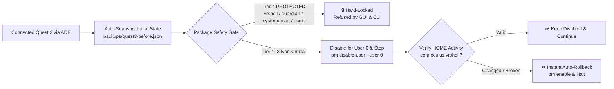

<div align="center">

# 🥽 Meta Quest 3 Debloater & Privacy Manager

**Safe, 100% Reversible ADB Debloating, Telemetry Control, and Horizon OS Tweaks for Meta Quest 3 / 3S / 2**

[](https://www.meta.com/quest/)
[-8b5cf6?style=for-the-badge)](#live-device-verification)
[](#quick-start)
[-f59e0b?style=for-the-badge)](#how-safety-works)
[](LICENSE)

*Disable Horizon Worlds bloat, advertising IDs, background federated learning, promo nags, and preinstalled demo apps without root — backed by automatic VR Home rollback protection.*

</div>

---

## 🖥️ Desktop Application Preview


> Also includes a standalone interactive browser selector ([`quest-debloat-selector.html`](quest-debloat-selector.html)) and cross-platform scripts for **PowerShell** (`scripts/debloat.ps1`) and **Bash** (`scripts/debloat.sh`).

---

## 🛡️ Architecture & Safety Pipeline

Because Meta Quest 3 headsets ship with a **locked bootloader** (`ro.boot.flash.locked=1`, `ro.boot.verifiedbootstate=green`), modifying `/system` is neither possible nor necessary. Every toggle uses user-space disabling (`pm disable-user --user 0`) and **never uninstalls** system packages:



### What Makes This Safe
- **Zero Uninstalls**: Disabled apps stay untouched on `/system` or `/product` and can be restored in seconds with `restore.ps1`, `restore.sh`, or **Restore All Meta Defaults**.
- **Hard-Locked Protected Tier**: 24 curated core packages + OS regex patterns (`51` installed OS, OpenXR runtime, Horizon entitlement, Guardian/spatial mesh, tracking calibration, Bluetooth, thermal alert, driver, and USB ADB packages locked on Quest 3 Android 14) cannot be checked or disabled even manually.
- **Per-Package HOME Integrity Check**: After disabling each package, the tool queries `cmd package resolve-activity` for `android.intent.category.HOME`. If the default VR launcher is no longer `com.oculus.vrshell`, it immediately re-enables the offending package and stops.
- **Full Pre-Debloat Backup**: Automatically records previously disabled packages before touching anything (`backups/quest3-<serial>-before.json`).

---

## 📊 Verified Live Results (Meta Quest 3 • `eureka` • Android 14)

Verified directly over ADB on stock locked Meta Quest 3 firmware (`UP1A.231005.007.A1`):

| Metric | Before Debloat (`status`) | After `apply --preset safe` |
| :--- | :--- | :--- |
| **Safe Tier Packages Disabled** | `0 / 50` | **`50 / 50` Disabled** |
| **Total Disabled Packages** | `1 / 396` (`com.meta.credentialsmanager`) | **`51 / 396`** |
| **Protected Core Packages** | `0 / 51` disabled | **`0 / 51` disabled (Locked)** |
| **VR Home Activity Check** | `com.oculus.vrshell/.HomeActivity` | **`com.oculus.vrshell/.HomeActivity`** |
| **RAM Relieved (Resident & Cached Bloat)** | 10 resident/cached daemons (`~1.0 GB+`) | **`0` active telemetry/bloat daemons** (Pass 2: `+292 MB` net / `+813 MB` kill delta; Pass 3: **`+822 MB` net / `+855 MB` kill delta**, `4.55 GB` `dumpsys` free RAM) |
| **CPU Headroom** | Periodic ad / ML / location / calendar wakeups | **`559% idle / 600%`** asleep (`574%` post-Pass 2) • **`334% idle`** in VR Shell at 72 FPS |
| **Storage (`/data/app` Reclaimable)** | `439G / 449G` (`9.3 GB` free) | **`0 MB` deleted** (reversible disable) • **`2.51 GiB`** reclaimable via optional uninstall |

---

## 🚀 Quick Start

### Prerequisites
1. Enable **Developer Mode** on your Meta Quest 3 (Meta Horizon mobile app -> *Devices -> Headset Settings -> Developer Mode*).
2. Connect your Quest 3 via USB-C (or Wireless ADB) and accept the **"Allow USB debugging?"** prompt inside the headset.
3. Have **ADB** installed (auto-detected from `PATH`, `Android\Sdk\platform-tools`, `platform-tools`, or `Programs\VRmoo\adb\adb.exe`).

### Option A: Windows Desktop GUI (Recommended)
Download [`QuestDebloater-win-x64.zip`](../../releases) (or build from source with `pwsh .\build.ps1`):
```powershell
# Launch the dark-theme desktop GUI
.\dist\QuestDebloater.exe
```

### Option B: Fast CLI Mode
```powershell
# Inspect headset telemetry, memory, and package counts
.\dist\QuestDebloater.exe status

# Save a timestamped backup snapshot
.\dist\QuestDebloater.exe backup

# Apply Safe Recommended preset (50 telemetry, ad, promo, QA & demo packages)
.\dist\QuestDebloater.exe apply --preset safe

# Or apply Telemetry & Ads only (21 packages) / PCVR Minimalist (65 packages)
.\dist\QuestDebloater.exe apply --preset telemetry
.\dist\QuestDebloater.exe apply --preset pcvr

# Restore everything back to Meta defaults
.\dist\QuestDebloater.exe restore
```

### Option C: Cross-Platform PowerShell & Bash Scripts
```powershell
# Windows PowerShell
pwsh .\scripts\debloat.ps1 -Preset safe
pwsh .\scripts\restore.ps1
```
```bash
# macOS / Linux / Git Bash / WSL
./scripts/debloat.sh safe
./scripts/restore.sh
```

### Option D: Interactive HTML Selector
Open [`quest-debloat-selector.html`](quest-debloat-selector.html) in any browser to customize individual packages and copy one-line ADB disable / restore commands.

---

## 📦 Curated Package Reference (100 Horizon OS Packages)

### Tier 1 — `SAFE` (`50` packages — Default Recommended Preset)
Disables zero-risk advertising, federated learning, background bug uploaders, promotional banners, A/B experimentation (`labservice`), enterprise MDM/OEM agents, QA automation, pre-reboot dumpsys hooks, wearable location polling, preinstalled social/demo wrappers, and unused phone/TV stubs while keeping the Meta Store, Browser, Link/Air Link, and all VR games working normally.

<details>
<summary><strong>1. Telemetry, Advertising, QA & Enterprise (21 packages — "Telemetry & Ads Only" Preset)</strong></summary>

| Package ID | Component | Affects (UAD Subsystem) | Purpose & Measured Impact |
| :--- | :--- | :--- | :--- |
| `com.meta.horizonadidservice` | Meta Horizon Ad ID Service | Ad Tracking & Personalized Ad ID | Stops Horizon advertising ID tracking & ad attribution |
| `com.meta.federatedcomputing.oculus` | Meta Federated Computing | Background ML Telemetry & CPU | Stops background ML training & telemetry harvesting |
| `com.android.adservices.api` | Android AdServices API | Android Privacy Sandbox Ad API | Disables Privacy Sandbox ad targeting API (`15.6 MiB` APEX) |
| `com.android.ext.adservices.api` | Extended AdServices API | Extended Ad Attribution Service | Disables extended Android ad attribution daemon (`12.7 MiB` APEX) |
| `com.android.ondevicepersonalization.services` | On-Device Personalization | On-Device Behavioral Ad Profiling | Disables behavioral ad profiling engine |
| `com.android.federatedcompute.services` | Android Federated Compute | Android Federated ML Telemetry | Stops background Android federated compute telemetry |
| `com.oculus.bugreportuploader` | Bug Report Uploader | Crash / Diagnostic Uploader | Prevents background diagnostic & crash uploads to Meta |
| `com.oculus.bugreportservice` | Bug Report Service | Background Bug Capture Daemon | Stops idle bug report collection daemon |
| `com.oculus.quickpromotionservice` | Quick Promotion / Upsells | VR Home Upsells & Promo Nags | Eliminates in-VR Horizon+ banners & promotional popups |
| `com.oculus.nux.ota` | Post-Update Onboarding Nags | Post-Update Promo Cards | Stops post-update promotional cards & wizards |
| `com.oculus.backuptransportservice` | Meta Cloud Backup Transport | Meta Cloud Backup Sync | Stops cloud sync telemetry (`24.1 MiB` ROM; ADB unaffected) |
| `com.oculus.q4b.mdm` | Quest for Business MDM | Quest Enterprise MDM Agent | Disables unused enterprise device management daemon |
| `com.facebook.wearable.system.location.service` | Wearable Location Service | Wearable Location Polling & RAM | Stops resident background location tracking (`~110 MB` RSS) |
| `com.facebook.wearable.system.location.proxy` | Wearable Location Proxy | Location Proxy Background RAM | Stops background location polling proxy (`~87 MB` RSS) |
| `com.oculus.labservice` | Oculus Lab Service | A/B Experiments Telemetry & RAM | Stops active A/B experimentation telemetry daemon (`~93 MB` PSS) |
| `com.oculus.oemconfig` | Oculus Enterprise OEM Config | Enterprise OEM Provisioning & RAM | Disables enterprise OEM configuration agent (`~107 MB` PSS) |
| `com.meta.automation.pauldron.vr` | Meta Pauldron QA Automation | Internal Meta QA Test Automation | Disables internal Meta QA test runner agent |
| `com.oculus.appautomation` | Oculus App Automation | UI / App Test Automation Harness | Disables automated UI test harness service |
| `com.android.cts.ctsshim` | Android CTS Test Shim | Android CTS Compliance Test Stub | Disables empty Android Compatibility Test Suite validation shim |
| `com.android.cts.priv.ctsshim` | Privileged CTS Test Shim | Privileged CTS Compliance Stub | Disables empty privileged CTS validation shim |
| `com.oculus.preshutdowntaskservice` | Pre-Shutdown Dumpsys Service | Pre-Reboot Dumpsys Telemetry & RAM (~98.5 MB) | Stops pre-shutdown dumpsys collection (`~98.5 MB` RSS / `84 KB` ROM) |

</details>

<details>
<summary><strong>2. Social Bloat, Preinstalled Demos & Unused Phone/TV Stubs (29 additional packages)</strong></summary>

| Package ID | Component | Affects (UAD Subsystem) | Measured Impact & Disk Footprint |
| :--- | :--- | :--- | :--- |
| `com.facebook.horizon` | Meta Horizon Worlds | Horizon Worlds App & Feed | Removes Horizon Worlds & feed clutter (`620.7 MiB` on `/data/app`) |
| `com.oculus.facebook` | Facebook VR App | Facebook Social VR App | Preinstalled Facebook wrapper (`150.7 MiB` removable `/data/app`) |
| `com.oculus.igvr` | Instagram VR App | Instagram Social VR App | Preinstalled Instagram wrapper (`271.8 MiB` removable `/data/app`) |
| `com.oculus.thvr` | Threads VR App | Threads Social VR App | Preinstalled Threads wrapper (`19.1 MiB` removable `/data/app`) |
| `com.facebook.arvr.quillplayer` | Theater Elsewhere / Quill | Theater Elsewhere Demo | Preinstalled showcase player (`25.6 MiB` removable `/data/app`) |
| `com.oculus.samples.firsthand` | First Hand Demo | First Hand Tracking Demo | Preinstalled hand tracking demo (`568.8 MiB` removable `/data/app`) |
| `com.meta.handseducationmodule` | Hands Education Module | Hand Gesture Tutorial Overlay | Interactive gesture onboarding (`174.6 MiB` removable `/data/app`) |
| `com.meta.curio.ruler` | Curio MR Ruler | MR Ruler Novelty Utility | Preinstalled MR novelty app (`70.0 MiB` removable `/data/app`) |
| `com.meta.curio.toybox` | Curio MR Toybox | MR Toybox Novelty Demo | Preinstalled MR novelty app (`310.8 MiB` removable `/data/app`) |
| `com.oculus.assistant` | Meta Voice Assistant | Voice Trigger & Mic Listener | Background voice trigger listener |
| `com.oculus.guidebook` | Quest Guidebook | Guidebook Tips Background Service | Resident onboarding tips service (`~112 MB` RSS / `39.0 MiB` `/data/app`) |
| `com.oculus.helpcenter` | Meta Help Center | Meta Help Viewer Service | Support article viewer (`~118 MB` RSS / `14.0 MiB` `/data/app`) |
| `com.oculus.vrprivacycheckup` | VR Privacy Checkup | Periodic Privacy Nags | Periodic privacy wizard nag (`16.0 MiB` removable `/data/app`) |
| `com.oculus.panelapp.calendar` | Oculus Calendar Panel | Legacy Home Calendar Widget | Legacy Home calendar widget (`11.5 MiB` `/data/app`) |
| `com.meta.environment.prod.nuxd` | Meta NUX Onboarding Daemon | New-User Setup Daemon | New-user onboarding daemon unneeded after setup (`6.9 MiB` ROM) |
| `com.meta.surfacetypingnux` | Surface Typing Tutorial | Direct-Touch Typing Tutorial | Onboarding direct-touch typing tutorial (`1.2 MiB` ROM) |
| `com.meta.HyperscapeHmdCapture` | Hyperscape Room Capture | Cloud Room Photogrammetry | Cloud capture app (`184.9 MiB` `/data/app`; Guardian intact) |
| `com.oculus.panelapp.kiosk` | Retail Kiosk Mode Panel | Retail Store Demo Kiosk | Commercial store demo kiosk panel |
| `com.microsoft.rdc.androidx` | Microsoft Windows App | Microsoft Remote Desktop Client | Preinstalled Remote Desktop client stub (`90.5 MiB` `/data/app`) |
| `com.android.managedprovisioning` | Work Profile Provisioning | Corporate Work Profile MDM | Corporate BYOD MDM provisioning wizard (`~95 MB` PSS / `5.6 MiB` ROM) |
| `com.android.providers.tv` | Android TV Provider | Unused Android TV Tuner DB | Unused TV tuner/channel database (`~99 MB` PSS) |
| `com.android.providers.calendar` | Calendar Storage Provider | Android Calendar Sync DB | Background calendar DB waking in RAM (`~99 MB` PSS) |
| `com.android.healthconnect.controller` | Health Connect Controller | Phone Health Connect UI | Phone fitness/health data controller UI (`6.1 MiB` APEX) |
| `com.android.health.connect.backuprestore` | Health Connect Backup | Phone Health Connect Backup | Background Health Connect cloud backup helper |
| `com.android.bookmarkprovider` | Legacy Bookmark Provider | Legacy AOSP Bookmark DB | Obsolete AOSP browser bookmark provider |
| `com.android.providers.blockednumber` | Blocked Number Provider | Phone Call-Blocking DB | Phone call-blocking DB (no cellular radio on Quest) |
| `com.android.nearby.halfsheet` | Nearby Share Halfsheet | Nearby Share Pop-up Stub | Google Nearby device pairing popup stub (`3.2 MiB` APEX) |
| `com.oculus.ovrmonitormetricsservice` | OVR Metrics Stub Service | Developer Metrics Factory Stub | Empty `1.0-stub` for optional developer OVR Metrics Tool (`12 KB` ROM) |
| `com.meta.linktabula.viewer` | Link Tabula Stub Viewer | Unused Internal LinkTabula Stub | Internal Meta viewer exposing only dummy `.StubActivity` (`288 KB` ROM) |

</details>

---

### Tier 2 — `MODERATE` (`15` additional packages — Included in "PCVR / Minimalist" Preset -> `65` total)
Ideal if you primarily use **Virtual Desktop**, **Steam Link**, **ALVR**, or **sideloaded APKs** and do not use Meta Parties, Avatars, Quest TV, Workrooms Remote Desktop, Live Captions, or extra 3D Home environments. Full Reddit (`r/OculusQuest`, `r/sidequest`, `r/QuestPiracy`) & `dumpsys` risk breakdown is in [`DISABLED_APPS_AND_INSTRUCTIONS.md`](DISABLED_APPS_AND_INSTRUCTIONS.md):

<details>
<summary><strong>View all 15 MODERATE packages & measured tradeoffs</strong></summary>

| Package ID | Component | Affects (UAD Subsystem) | Tradeoff & Community / Live Risk Note |
| :--- | :--- | :--- | :--- |
| `com.oculus.socialplatform` | Oculus Social Platform | Parties, Voice Chat & Friends (`140–547 MB` RSS) | Removes "People you may know" / Discover People feed, but **breaks Parties, Friends list & voice calls** |
| `com.oculus.presence` | Live User Presence Service | Friends Online Status (`168–228 MB` RSS) | May trigger `"presence keeps stopping"` toasts on some builds unless `socialplatform` is also disabled |
| `com.meta.rl.trust.service` | Reality Labs Consent & Privacy UI | On-Boot ToS / Consent Prompts (`120–138 MB` RSS) | Handles regional privacy/ToS dialogs after NUX or major OTAs; re-enable temporarily if prompted after an update |
| `com.oculus.mrds` | Meta Remote Desktop Service | Workrooms / Remote Desktop Daemon (`4.5 MiB`) | Companion daemon for `com.oculus.remotedesktop`; safe to disable when using Virtual Desktop / Steam Link |
| `com.oculus.captionservice` | Horizon OS Live Captions | System Speech-to-Text Captions (`7.0 MiB`) | Accessibility closed-captions overlay; safe if you don't use system live captions |
| `com.oculus.remotedesktop` | Meta Remote Desktop | Workrooms Remote Desktop Panel (`145–187 MB` RSS) | Built-in remote desktop panel; unneeded with Virtual Desktop / ALVR |
| `com.oculus.horizonmediaplayer` | Meta Horizon Media Player | Built-in Media Player (`~147 MB` RSS / `125 MB` PSS) | Removes stock 2D/VR file player UI; 3rd-party players (SkyBox/DeoVR) unaffected |
| `com.oculus.tv` | Meta Quest TV | Quest TV 180/360 Streaming (`~146 MB` RSS) | Removes built-in Quest TV catalog |
| `com.oculus.avatareditor` | Meta Avatar Editor | 3D Avatar Editor & Assets | Disables editing 3D Meta Avatars |
| `com.oculus.accountscenter` / `com.meta.AccountsCenter.pwa` | Accounts Center + PWA | Meta / IG / FB Account Linking Settings | Removes cross-app social linking UI (headset auth stays intact) |
| `com.meta.shell.env.vista.*` (`4` themes) | Calming / Focused / Horror / Oceanarium | Extra Vista Virtual Home Skyboxes | Removes 4 optional home environments while keeping default `haven2025` intact |

</details>

### Tier 3 — `CAUTION` (`11` optional manual toggles)
Available in the GUI with orange warning badges (never auto-disabled by presets):

<details>
<summary><strong>View all 11 CAUTION packages & Android 14 / OTA notes</strong></summary>

| Package ID | Component | Affects (UAD Subsystem) | Measured / Forum Caution Note |
| :--- | :--- | :--- | :--- |
| `com.oculus.store` | Meta Horizon Store | Official Store & App Updates (`167–274 MB` RSS) | Highest single UI RAM user, but breaks Store browsing & app updates |
| `com.oculus.systemintelligence` | System Intelligence & TTS | Voice Dictation, TTS & `DeviceConfig` (`~208 MB` RSS) | `UPDATED_SYSTEM_APP` (`57.3 MiB`); breaks OS TTS/dictation and may update via OTA |
| `com.oculus.metacam` | Horizon Camera & Recording UI | Screenshots, Video Recording & Cast UI (`139–166 MB` RSS) | Disabling breaks native VR screenshots, video capture, and sharing panel |
| `com.oculus.notification_proxy` | Notification Proxy *(Oculess)* | Phone Notification Mirror (`PERSISTENT`) | Flagged `PERSISTENT` on Horizon OS Android 14+; disabling can fail with `SecurityException` or silence alerts |
| `com.oculus.appsafety` | App Safety Integrity Monitor | Sideloaded App Policy Scanner (`118–122 MB` RSS) | Legacy Oculess target; monitors sideloaded APKs (`r/QuestPiracy`) |
| `com.oculus.websafety` | Web Safety Filter | Browser Malicious URL Filter (`2.2 MiB`) | URL checker used by `com.oculus.browser` |
| `com.oculus.hzosgallery` | Horizon OS Media Gallery | VR Screenshots & Gallery (`116–157 MB` RSS) | Removes built-in media viewer; files remain readable via USB/MTP |
| `com.oculus.magicislandcastingservice` | Meta Native Casting Service | Native Horizon OS Cast Receiver | Breaks official browser/phone casting (ADB/scrcpy casting unaffected) |
| `com.oculus.xrstreamingclient` / `com.meta.pclinkservice.server` | Quest Link / Air Link + Server | Official USB Link & Wireless Air Link | Only disable if using **Virtual Desktop**, **Steam Link**, or **ALVR** exclusively |
| `com.oculus.browser` | Meta Quest Browser | Built-in WebXR Chromium Browser | Removes default WebXR / OAuth external browser fallback |

</details>

### Tier 4 — `PROTECTED` (`24` curated + OS core regex — Hard-Locked, `51` installed locked on Quest 3)
Never disabled under any circumstance: `com.oculus.vrshell`, `com.oculus.systemux`, `com.oculus.systemdriver`, `com.oculus.horizon` (`~208 MB` core auth/entitlements), `com.facebook.spatial_persistence_service` (`~153 MB` room anchors/Guardian mesh), `com.oculus.linefrequencyservice` (tracking camera anti-flicker), `com.oculus.bodyapiservice` (IOBT/hand tracking API), `com.oculus.connectivity.bluetooth`, `com.oculus.vralertservice` (thermal/battery safety alerts), `com.oculus.integrity`, `com.oculus.guardian*`, `com.oculus.ocms` (Library/DRM — breaking `ocms` breaks Library on v76+), `com.oculus.userserver2`, `com.oculus.companion.server`, `com.oculus.identitymanagement.service`, `com.oculus.deviceauthserver`, `com.meta.systemui`, `horizonos.platform`, `horizonos.openxr.runtimebroker`, `oculus.platform`, plus all `com.oculus.os.*`, `com.qualcomm.*`, and Android system frameworks.

---

## 🌐 Optional Companion Layer: Network / DNS Blocking

Some low-level firmware daemons (such as `com.oculus.updater`) are protected by Android (`Cannot disable a protected package`) and cannot be stopped via ADB alone. To block outbound Meta telemetry or OS updates at the network level, import [`configs/adguard-meta-telemetry.txt`](configs/adguard-meta-telemetry.txt) into **AdGuard Home** or **Pi-hole**.

---

## 🛠️ Build From Source

Requires **.NET 8 SDK** on Windows:
```powershell
pwsh .\build.ps1
```

## 🙏 Acknowledgements & Prior Art

- Package research and conservative safety classification inspired by [`nlhomme/cleanyourquest`](https://github.com/nlhomme/cleanyourquest) and [`matmon3/Detoxification-Control`](https://github.com/matmon3/-DETOXIFICATION-CONTROL-Android-devices-metaQuest-Manager-Debloat-Telemetry-ADB-APK-tools-).
